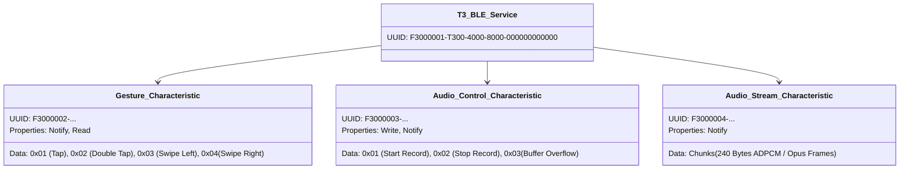
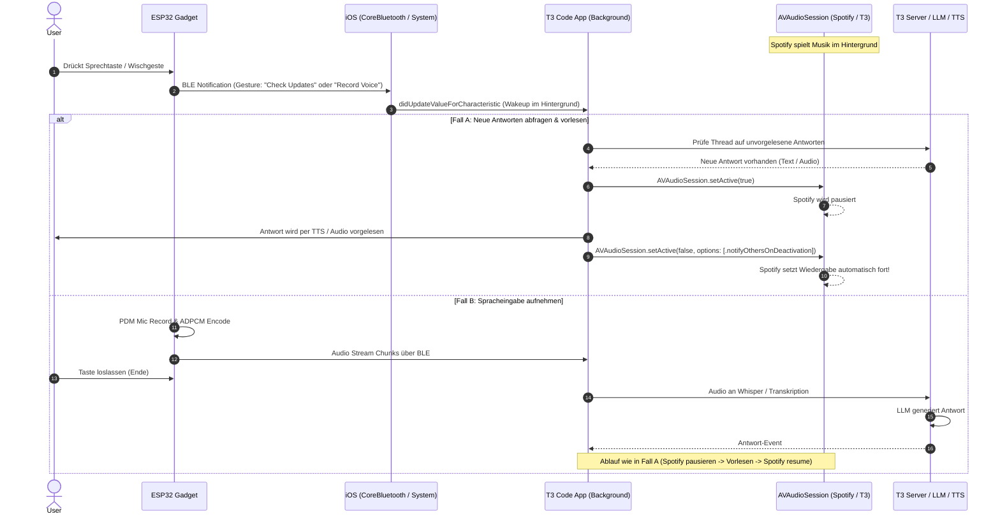

# Hardware- & Architektur-Spezifikation: T3 Code ESP32 Wearable Mic Gadget

## 1. Systemübersicht & Use Case

Das **T3 Code ESP32 Mic Gadget** ist ein ultrakompaktes, drahtloses Wearable/Pocket-Device (z. B. Ring, Clip, Anhänger oder Mini-Fernbedienung), das es dem Nutzer ermöglicht, mit **T3 Code** zu interagieren, während das **iPhone gesperrt in der Tasche** verbleibt und ggf. Hintergrundmusik (z. B. Spotify) läuft.

### Kernanforderungen

1. **Gesten- & Tastersteuerung**:
   - Taster (Click / Long Press / Double Click)
   - Wischgesten (Swipe Left / Swipe Right) oder IMU-Tap-Gesten
2. **Sprachaufnahme am Gadget**:
   - Audio wird direkt auf dem Mikrofon des Gadgets aufgezeichnet.
   - Übertragung der Audiodaten über Bluetooth Low Energy (BLE) an das iPhone.
   - Umgehung der restriktiven iOS-Mikrofon-Hintergrund-Blockaden (kein interner iPhone-Mic-Zugriff nötig).
3. **Spotify-Ducking & Auto-Resume**:
   - Bei neuer Antwort oder manueller Abfrage pausiert das iPhone Spotify automatisch.
   - Antwort wird per TTS über die iPhone-Lautsprecher oder verbundene Kopfhörer (z. B. AirPods) vorgelesen.
   - Nach Ende der Sprachausgabe setzt Spotify die Musikwiedergabe an exakt derselben Stelle fort.
4. **Kein permanenter Akkuverbrauch**:
   - Deep Sleep / Low Power BLE Standby auf dem ESP32.
   - iOS-App wird nur bei BLE-Events via `CoreBluetooth State Restoration` im Hintergrund geweckt.

---

## 2. Hardware-Optionen im Vergleich

Für die Realisierung stehen verschiedene Entwicklungsansätze zur Verfügung:

| Hardware-Plattform                   | Formfaktor                          | Integriertes Mikrofon                     | Integrierte Gesten / Touch                            | Akku- & Lademanagement                          | Eignung / Fazit                                |
| :----------------------------------- | :---------------------------------- | :---------------------------------------- | :---------------------------------------------------- | :---------------------------------------------- | :--------------------------------------------- |
| **Seeed Studio XIAO ESP32-S3 Sense** | 21 × 17.5 mm (Briefmarke)           | ✅ Ja (Digitales PDM-Mic auf Addon-Board) | ⚠️ Über Touch-Pins (GPIO) oder ext. Sensor            | ✅ Ja (Lade-IC on-board, 3.7V LiPo Pads)        | **Bester DIY-Kandidat für Ring/Clip/Anhänger** |
| **M5Stack Atom Echo**                | 24 × 24 × 17 mm (Fertiggehäuse)     | ✅ Ja (I2S SPM1423) + Lautsprecher        | ⚠️ Nur 1 programmierbarer Button                      | ❌ Kein Akku intern (braucht externe LiPo-Base) | Sehr gut für Tisch-Puck / Schreibtisch         |
| **M5StickC Plus2**                   | 48 × 25 × 13 mm (Stick mit Display) | ✅ Ja (SPM1423 Mic) + Piezo               | ✅ 6-Achsen-IMU (Schüttel-/Klopferkennung) + 3 Taster | ✅ Ja (200 mAh LiPo integriert)                 | **Schnellster Prototyp ohne Löten**            |
| **LilyGO T-Watch S3 / T-Wristband**  | Smartwatch- / Armbandgehäuse        | ✅ Ja (PDM-Mic)                           | ✅ Kapazitiver Touchscreen / Touch-Taste + IMU        | ✅ Ja (LiPo + Ladeschaltung + Display)          | Beste Option für ein Handgelenk-Wearable       |

---

## 3. Detail-Betrachtung der Optionen

### Option A: Seeed Studio XIAO ESP32-S3 Sense (Empfohlen für Miniatur-Wearable)

- **Prozessor**: ESP32-S3 (Dual-Core Xtensa LX7, 240 MHz, 8 MB PSRAM, 8 MB Flash, BLE 5.0).
- **Mikrofon**: Direkt auf der kleinen aufsteckbaren Tochterplatine integriert (Digitales PDM-Mikrofon `MSM261D3526H1CPM`).
- **Gesten/Touch**:
  - Der ESP32-S3 besitzt **14 native kapazitive Touch-Kanäle**.
  - Man benötigt **keine zusätzlichen Touch-ICs**: Zwei bis drei kleine Kupferfolien-Streifen oder leitfähige Kunststoffflächen am Gehäuse genügen, um Wischgesten (Swipe left/right) und Taps kapazitiv zu erfassen.
- **Größe**: Extrem klein (~21 × 17.5 × 10 mm inkl. Sense-Board und kleiner LiPo-Zelle).

### Option B: M5StickC Plus2 (Turnkey-Lösung für sofortigen Start)

- **Komponenten**:
  - ESP32-PICO-V3-02
  - Integriertes digitales Mikrofon (SPM1423, I2S)
  - 1.14 Zoll Farbdisplay (TFT) zur Statusanzeige (z. B. "Streaming...", "Antwort erhalten")
  - MPU6886 6-Achsen-IMU (Gyroskop & Beschleunigungssensor) -> erkennt Gesten wie Handgelenk-Drehung, Doppeltipp auf das Gehäuse oder Schütteln
  - 200 mAh Akku, Ein/Aus-Schalter, 3 Buttons
- **Vorteil**: Null Hardware-Bastelei erforderlich. Ideal zum sofortigen Testen der Firmware und iOS-Software.

### Option C: LilyGO T-Watch S3 (All-in-One Smartwatch / Ring-Alternative)

- Bietet fertiges Uhrengehäuse mit Armband, kapazitivem Touch-Display (Touch-Swipe links/rechts out-of-the-box), PDM-Mikrofon, Vibrationsmotor für haptisches Feedback und BLE 5.0.

---

## 4. BLE-Audio-Übertragung: Herausforderung & Lösung

### Das Problem

Unkomprimiertes Audio (16 kHz, 16 Bit Mono PCM) erfordert:
$$16.000 \times 16 \text{ Bit} = 256 \text{ kbit/s} = 32 \text{ kB/s}$$
Über BLE GATT mit Standard-MTU kann ein solcher Datenstrom zu Paketverlusten oder Verzögerungen führen.

### Die Lösung: On-Device Audio-Kompression

Da der ESP32-S3 über Hardware-Rechenleistung und reichlich RAM verfügt, komprimiert die Firmware den Audiostrom vor dem Senden:

1. **Option 1: IMA-ADPCM (Sehr ressourcenschonend, 4:1 Kompression)**
   - Reduziert die Datenrate von 256 kbit/s auf **64 kbit/s** (~8 kB/s).
   - Benötigt praktisch keine CPU-Leistung auf dem ESP32.
   - Kann absolut verlustfrei und latenzarm über ein Standard-BLE-GATT-Merkmal (`Audio Data Characteristic`) übertragen werden.
   - Auf dem iPhone decodiert eine minimale Swift/C-Routine das ADPCM wieder in PCM.

2. **Option 2: Opus Codec (Hohe Sprachqualität, bis zu 16:1 Kompression)**
   - Sprachbandbreite: 16–24 kbit/s (~2–3 kB/s).
   - Perfekt für Whisper, läuft nativ auf ESP32-S3 mit der offiziellen Espressif Audio Framework (`esp-adf` / `libopus`).

---

## 5. BLE GATT-Profil Spezifikation



---

## 6. iOS Integration & Audio-Session Lifecycle

### Architektur & Ablauf



### Der entscheidende Swift-Code für die Audio-Session

```swift
// 1. Vor dem Vorlesen aktivieren:
let audioSession = AVAudioSession.sharedInstance()
try audioSession.setCategory(.playback, mode: .spokenAudio, options: [.duckOthers]) // oder ohne duckOthers für vollen Pause-Modus
try audioSession.setActive(true)

// ... Sprachausgabe läuft ...

// 2. Nach Ende der Sprachausgabe deaktivieren mit Resume-Signal für Spotify:
try audioSession.setActive(false, options: [.notifyOthersOnDeactivation])
```

---

## 7. Zusammenfassung der Hardware-Empfehlung

1. **Für sofortigen Software-Start (0 Tage Hardware-Aufwand)**:
   - **M5StickC Plus2** bestellen (~25 €).
   - Sofort einsatzbereit mit Mikrofon, Display, Tasten, IMU-Gesten und Akku im fertigen Kunststoffgehäuse.
2. **Für das finale Miniatur-Wearable (z. B. 3D-Druck-Gehäuse / Ring / Clip)**:
   - **Seeed Studio XIAO ESP32-S3 Sense** (~14 €) + flache 100–150 mAh LiPo-Zelle (~5 €).
   - Gehäuse aus dem 3D-Drucker mit 2 integrierten Touch-Kupferflächen für Wischgesten und PDM-Mikrofonöffnung.
